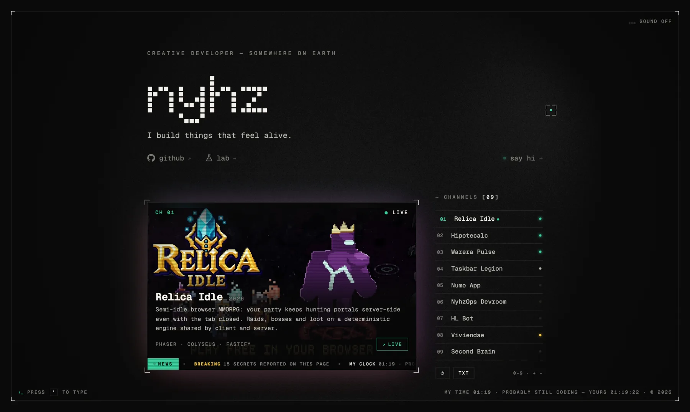

<div align="center">

# nyhz.dev

**I build things that feel alive.**

The portfolio of a creative developer: one screen, a CRT television, and every project on its own channel.

[**www.nyhz.dev**](https://www.nyhz.dev) · [the lab](https://www.nyhz.dev/lab/) · [how the tv was built](https://www.nyhz.dev/lab/tv/)

<br>

[](https://www.nyhz.dev)

</div>

<br>

## What's on screen

- **A television, not a grid.** Each project is a channel. Click one, or type its number, and the set powers on like an old tube, from a line of light. Hit `TXT` for the teletext.
- **It's live.** Every deployed project's dot pings its real deploy. The news ticker carries my latest push, and the clock in the corner is my time next to yours.
- **A grain field behind everything.** Raw WebGL with no library, plus an ambilight that tints the room with whatever the tv is showing.
- **A terminal.** Press the key under <kbd>Esc</kbd> and type.
- **15 secrets, plus one for phones.** The site counts them for you. No spoilers here.
- **[The lab](https://www.nyhz.dev/lab/):** long reads on how the parts that took more than one try were built, step by step and with the code.

Moving between the tv and the lab never reloads: the grain keeps drifting and the page crossfades underneath it.

## Built with

| | |
|---|---|
| Framework | [Astro](https://astro.build), static output with a client router and view transitions |
| Motion | [GSAP](https://gsap.com) for the timelines; hand-written `requestAnimationFrame` loops everywhere else |
| Graphics | Raw WebGL (the grain) and 2D canvas (the static between channels, the ambilight) |
| Content | YAML and Markdown in `src/content/`, edited locally with [Keystatic](https://keystatic.com) |
| Server | Three serverless routes on [Vercel](https://vercel.com): contact (via [Resend](https://resend.com)), deploy status and GitHub activity |
| Tests | [Vitest](https://vitest.dev) for the logic that doesn't need a DOM |

No UI framework ships to the browser. Each component is an `.astro` file with its own script, so the page stays light.

## Run it

```sh
pnpm install
pnpm dev        # http://localhost:4321 · the editor at /keystatic
pnpm test       # unit tests
pnpm check      # types
pnpm build      # production build (Vercel adapter)
```

The site runs without any configuration. Only the server routes read environment variables:

| Variable | Used by | |
|---|---|---|
| `RESEND_API_KEY` | `/api/contact` | sends the contact form |
| `CONTACT_TO`, `CONTACT_FROM` | `/api/contact` | where it goes, and who it's from |
| `GITHUB_TOKEN` | `/api/activity` | optional and read-only; without it the ticker falls back to public repos |

## Where things live

```
src/
  pages/          index (the tv) · lab/ (the posts) · api/ (serverless routes) · 404
  components/     one .astro file per piece: Tv, Hero, Terminal, Eggs, Loader, Field…
  scripts/        the logic, framework-free, and what the tests import
  content/        profile.yaml · projects/*.yaml · lab/*.md
  styles/         tokens and globals
public/projects/  each channel's picture
tests/            vitest
```

Every component script sets itself up through `onPage()` (`src/scripts/page.ts`). It runs once per page visit and gets an `AbortSignal` that tears down its listeners, timers and loops when the router swaps the page away.

## License

The code is [MIT](LICENSE): learn from it and take what's useful. The personal content is not covered: the name, the texts in `src/content/` and the images in `public/` stay mine.

<br>

<div align="center">
<sub>Made by <a href="https://github.com/Nyhz">nyhz</a> — come say hi on <a href="https://www.nyhz.dev">nyhz.dev</a>.</sub>
</div>
